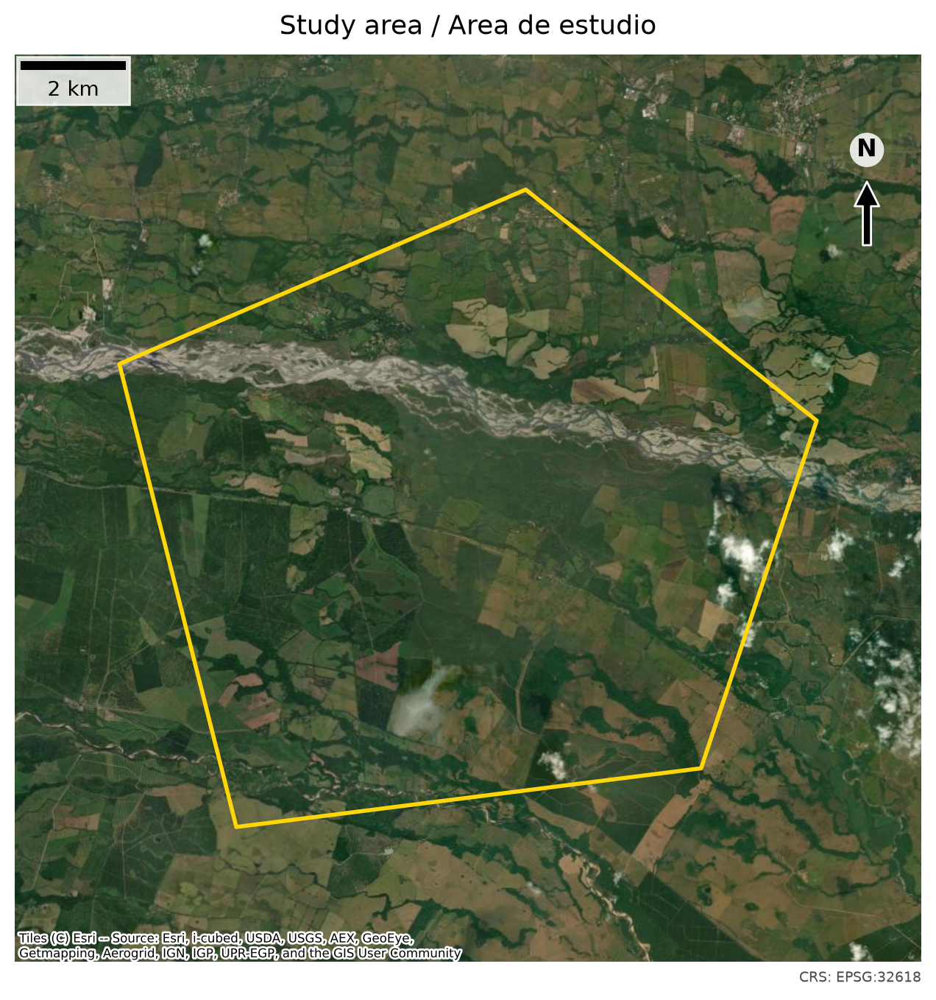

# Geo Project Template

<!--
How to use this template:
1. Click "Use this template" > "Create a new repository" on GitHub.
2. Replace the title above with the project title, every UPPERCASE placeholder, and "geo-project-template" with the new repository name (Colab badge, "Reproduce it" section and the REPO variable in notebooks/01_analysis.ipynb).
3. Replace outputs/maps/preview.png with the main map of the project (src/maps.py > plot_aoi_map).
4. Delete this comment block.
-->



[](https://colab.research.google.com/github/albertolozada/geo-project-template/blob/main/notebooks/01_analysis.ipynb)
[](LICENSE)

**Template for reproducible remote sensing and GIS projects: CRS checks, location map, Colab-ready notebook and a standard README.**

## Question

What does this project try to answer, and why does it matter for carbon projects or forest monitoring?

## Study area

- **Location:** country, region
- **Extent:** bounding box or source of the boundary
- **Area:** hectares, computed in EPSG:XXXX

## Data

| Dataset | Source | Licence | Original CRS | Period |
|---|---|---|---|---|
| Example: Global Forest Change | Hansen et al. / UMD | CC BY 4.0 | EPSG:4326 | 2001-2024 |

Raw data is not stored in this repository. `notebooks/01_analysis.ipynb` downloads it or explains how to get it (see [`data/README.md`](data/README.md)).

## Method

1. Load the layers and **check the CRS of every layer**.
2. Reproject to a metric or equal-area CRS (state which one and why).
3. Analysis steps.
4. Validation: how the result was checked.

## Results

Main numbers, the main map and a short interpretation.

## Limitations and data quality

- **CRS used for areas and distances:** EPSG:XXXX
- **Completeness:** how many features had missing or invalid values
- **Known gaps:** cloud cover, missing dates, resolution, etc.

## Reproduce it

**In your browser:** click the "Open in Colab" badge above.

**On your computer:**

```bash
git clone https://github.com/albertolozada/geo-project-template.git
cd geo-project-template
conda env create -f environment.yml
conda activate geo-project
jupyter lab notebooks/01_analysis.ipynb
```

## Repository structure

```
├── data/            raw and processed data (not versioned, see data/README.md)
├── notebooks/       analysis notebooks, numbered in execution order
├── outputs/maps/    maps and figures used in this README
├── src/             reusable functions (CRS checks, helpers)
└── environment.yml  Python environment
```

## Author

**Alberto Lozada Silva**, forestry engineer and carbon project auditor.
Portfolio: [albertolozada.github.io](https://albertolozada.github.io) · [LinkedIn](https://www.linkedin.com/in/alberto-lozada-silva/)

## Licence

Code under the [MIT License](LICENSE). Data keeps the licence of its original source.
